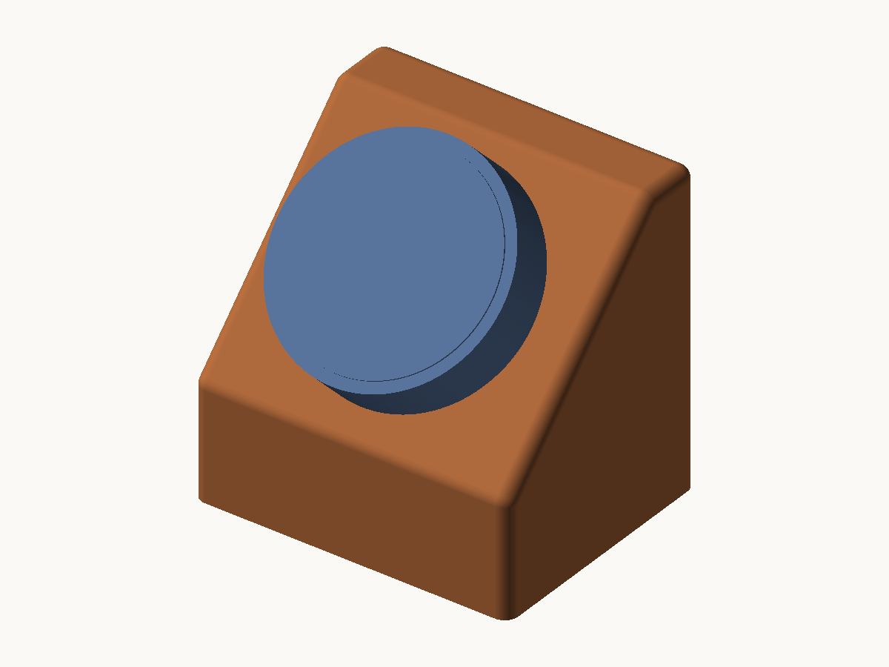
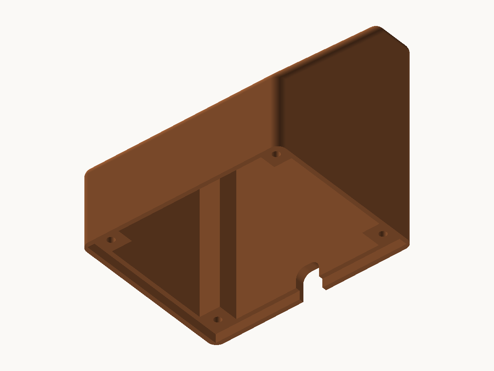
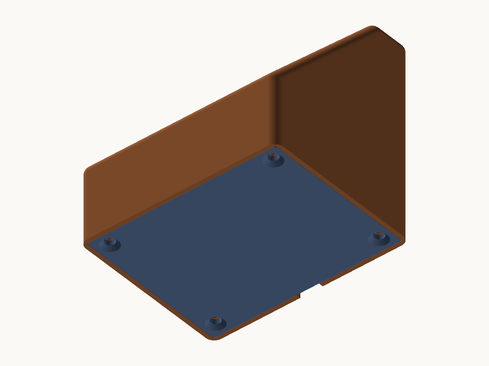
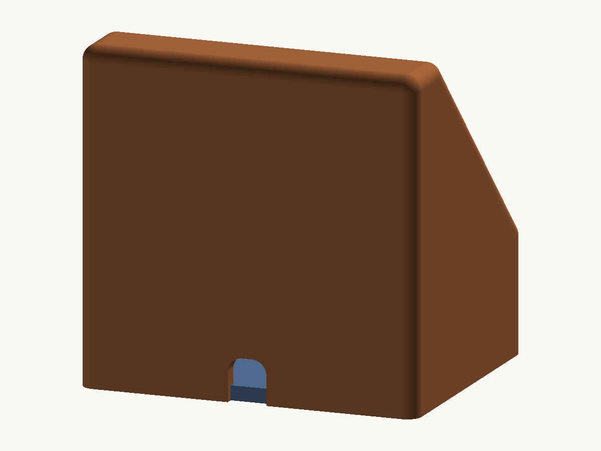
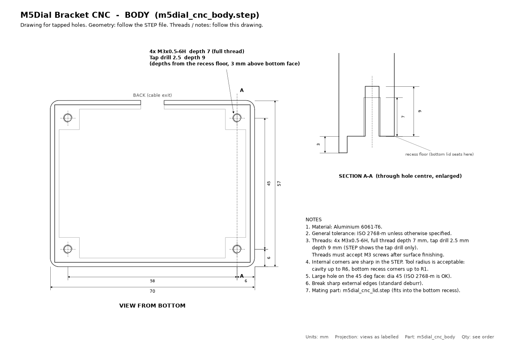
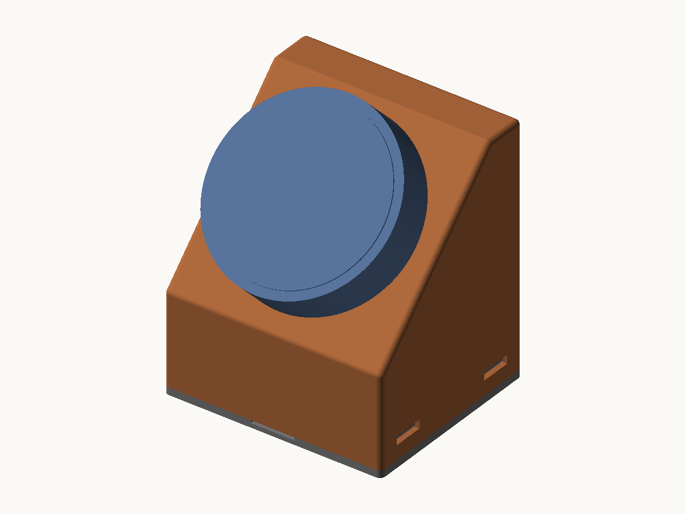
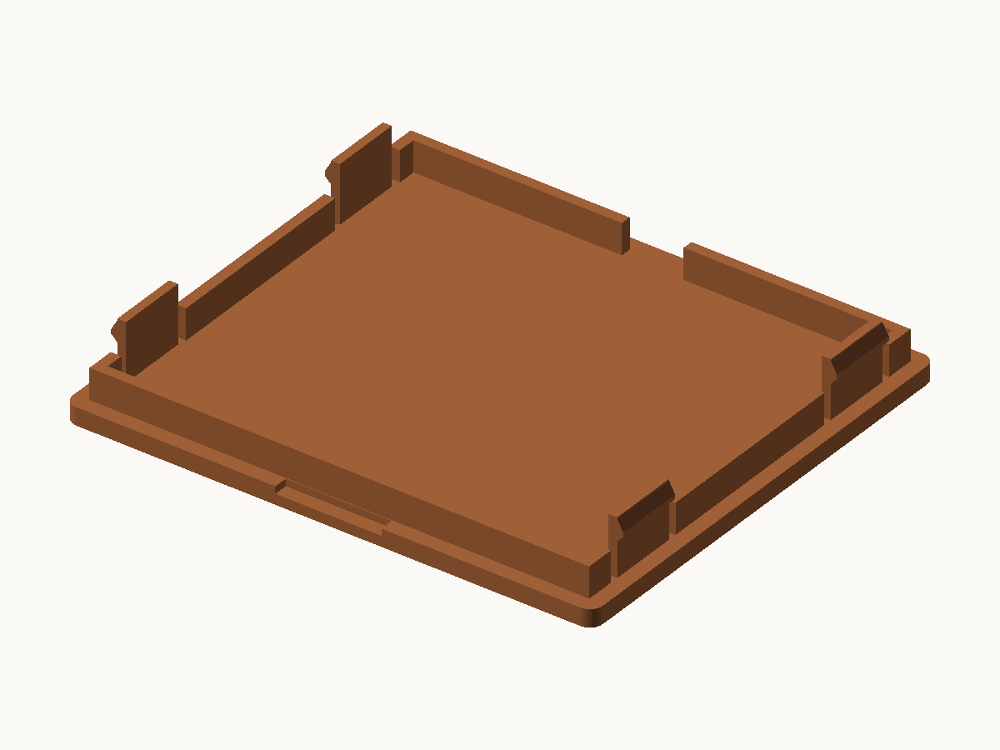
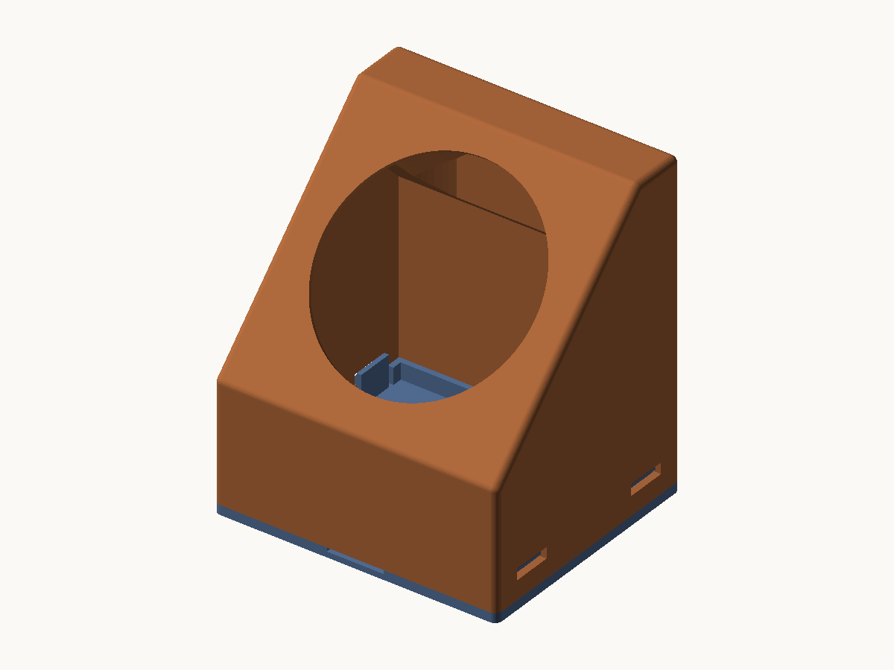
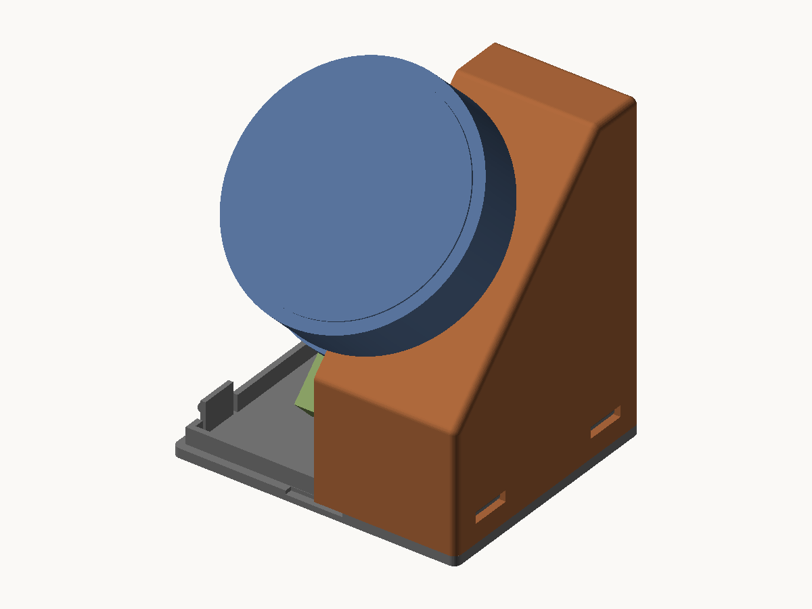

# これは何?
M5Dialをいいかんじにマウントするstlファイルだよ！

| 版 | 形 | ファイル | 外形（幅×奥行き×高さ） |
|---|---|---|---|
| **CNC**（削り出し） | v2 ベース・底蓋をタップ止め | [`cnc/`](cnc/) `m5dial_cnc_body.step` ＋ `m5dial_cnc_lid.step` | 70 × 57 × 68.1 mm |
| **v2**（3D プリント） | 底蓋付きの箱型・45° スロープ | [`3dprint/`](3dprint/) `m5dial_v2_body.stl` ＋ `m5dial_v2_lid.stl` | 60 × 53 × 68.0 mm |
| v1（[リリース v1.0](https://github.com/kohnan-kitchen/M5Dial_Bracket/releases/tag/v1.0)） | 三角フレーム | [`3dprint/`](3dprint/) `m5dial.stl` | 112 × 70 × 67 mm |

どれも M5Dial 付属のリングナットで固定するパネルマウント方式。
v1 / v2 は追加のネジ・ナットが不要。CNC 版は底蓋だけ M3 の皿小ねじ 4 本で留める。

```
cnc/        CNC 版（STEP・加工指示図 PDF・発注用 zip・生成スクリプト）
3dprint/    3D プリント版（v2 の STL と生成スクリプト、v1 の SCAD / STL）
preview.py  STL → PNG のプレビュー（共通）
```


## CNC 版（アルミ削り出し・底蓋タップ止め）



v2 の形（45° スロープ・パネルマウント）をベースに、3 軸マシニングで削れるように作り直した版。

| 部品 | ファイル | 材料（想定） |
|---|---|---|
| 本体 | `m5dial_cnc_body.step`（確認用 `.stl`） | A5052 などのアルミブロック |
| 底蓋 | `m5dial_cnc_lid.step`（確認用 `.stl`） | A5052 板 t3 |

- 外形: 70 × 57 × 68.1 mm（底蓋は本体の内側に収まり、底面と面一）。質量は本体 約 135〜147 g（内隅に残る工具 R による）＋底蓋 約 28 g（A5052）、Dial 込みで約 210〜222 g
- 斜面は 45°、台座（斜面が始まるまでの垂直壁）の高さは 25mm で v2 と同じ
- 壁厚 3mm（スロープも 3mm。Dial の締結範囲 1〜7.55mm の内側）
- 外形の稜と角は R3（底面の縁は角のまま）

### v2 からの変更点

- 内側の空洞は、**底から上へ掘るだけで届く形**にした（アンダーカットなし）。
  v2 のチェンバーや切妻天井をやめ、外形を壁厚 3mm だけ内側へ寄せた単純な殻にした。
  リングナットはスロープの内面（45° の平面）に当たる
- 内側（組み立てると見えない面）には R を付けず、モデルは角のまま。加工で残る工具の R は
  **R6 まで可**（φ12 エンドミル／ボールエンドミル）。内隅を R6 で削った形でも
  Dial・ナット・USB-C プラグに当たらないことをスクリプトで確認している
- 内隅に R6 が残ってもナットに掛からないよう、幅 60→70、奥行き 53→57、スロープ長 58→61 に広げ、
  Dial の位置を 1.5mm 上げた
- 底蓋はスナップ爪をやめ、**本体の底に彫った段（深さ 3mm）に落とし込む平板**にした。
  段の部分だけ壁が 1.5mm になり、底蓋（66.8 × 53.8 × 3、隙間は片側 0.1）が本体の底面と面一に収まる。
  **M3 の皿小ねじ 4 本**で、本体の隅の柱（10 × 10・全高）のタップ穴に留める
- ケーブル出口は背面壁の下端の切り欠き（底蓋の上面から幅 8 × 高さ 6、上の 2 つの角は外形と同じ R3）







### 加工指示（加工先に渡す内容）

| 項目 | 内容 |
|---|---|
| 底蓋の段 | 本体の底面から深さ 3.0、外面から 1.5mm 内側（内寸 67.0 × 54.0）。内隅はモデルでは角、R1 以下で可 |
| 本体の M3 タップ | 段の底面の 4 か所（外面の各辺から 6mm）。下穴 φ2.5 深さ 9、有効ねじ深さ 7 |
| 底蓋 | 外形 66.8 × 53.8（角 R0.9。段の内隅の R1 を逃がす）× t3。段との隙間は片側 0.1 |
| 底蓋の穴 | 4 か所（同位置）。φ3.4 キリ、下面側に 90° 皿もみ φ6.0（縁まで約 1mm 残る） |
| ねじ | M3×8 皿小ねじ（JIS B 1111 相当）×4。ねじのかかり 5mm |
| Dial の穴 | φ45.0（+0.1/0）、スロープ面に直交して貫通 |
| 外形の稜と角 | R3（底面の縁を除く） |
| ケーブル出口 | 背面壁の下端、幅 8 × 本体の底面から高さ 9、上の角 R3 |
| 内隅（空洞） | モデルは角のまま。工具の R は R6 以下で可 |
| 指示のない角 | 糸面取り（C0.3〜0.5 程度） |
| 表面処理 | 未指定（アルマイトの有無・色は要決定） |

STEP にはタップの情報が入らない（下穴 φ2.5 として入っている）。タップ位置・深さは加工指示図 `m5dial_cnc_body.pdf`（英語）で伝える。JLCCNC では本体の「穴あけ」を「はい」にして、この PDF を STEP と一緒に出す。



### 加工工程の想定（3 軸）

1. **OP1 底面側**: 底面を仕上げ → 空洞をポケット加工（φ12 フラットで荒取り・壁の仕上げ、
   スロープの裏と天面の裏は φ12 ボールで仕上げ）→ 底蓋の段（内隅は R1 以下なので φ2 以下で隅を仕上げ）
   → M3 の下穴とタップ。
   空洞の最深部は底から約 65mm なので、突き出し 70mm 以上の工具が要る
2. **OP2 側面置き**（幅方向を鉛直）: 外形の五角形を輪郭加工（スロープ・天面・背面の境の R3 は輪郭の円弧として出る）。
   左右の側面の外周の稜の R3 はコーナー R カッターで仕上げる
3. **OP3 45° 傾斜治具**（またはサインバイス）: スロープ面を水平にして φ45 穴をヘリカル加工で貫通
4. **OP4 背面を上**: ケーブル出口を φ6 以下のエンドミルで輪郭加工
   （上の角の R3 は背面から見た形なので、底面側からは出せない）

推測: 工程・工具・公差は設計側の想定。見積の前に加工先と確認すること。


### 組み立て

1. Dial のリングナットを外し、USB-C の L 字プラグを挿しておく
2. ケーブルを底の開口から通し、Dial をスロープの穴へ前から差し込む
   （USB-C が斜面の下側を向く角度で。v2 と同じ）
3. 底の開口から手を入れ、リングナットを手締めする
4. ケーブルを背面の切り欠きに通し、底蓋を底の段にはめて M3 の皿小ねじ 4 本で留める

### 再生成

```
uv venv -p 3.12 .venv-cnc
VIRTUAL_ENV=.venv-cnc uv pip install build123d trimesh manifold3d shapely rtree matplotlib
cd cnc
../.venv-cnc/bin/python m5dial_cnc.py              # STEP / STL を出力
../.venv-cnc/bin/python m5dial_cnc.py --assembly   # 確認用モック（Dial・USB-C・底蓋）も出力
../.venv-cnc/bin/python cnc_drawing.py             # 本体の加工指示図 m5dial_cnc_body.pdf
python3 ../preview.py m5dial_cnc_body.stl          # プレビュー PNG
```

寸法はすべて `m5dial_cnc.py` 冒頭の定数。同じ実行で次を検証する:
形状の正当性・watertight、部品間の干渉（本体・底蓋・Dial とナット・USB-C プラグ）、
リングナットへの手の届き、底から 3 軸で掘れること（アンダーカットなし）、ねじのかかりと肉厚、
皿もみから底蓋の縁までの残り。


## v2（底蓋付き・小型）



v1 の三角フレームを、底蓋で完全に閉じられる箱型に作り直した版。

| 部品 | ファイル | 印刷姿勢 |
|---|---|---|
| 本体（45° スロープ筐体） | `m5dial_v2_body.stl` | そのまま（設置姿勢）・サポート不要 |
| 底蓋（スナップ爪 4 本） | `m5dial_v2_lid.stl` | そのまま（板が下）・サポート不要 |

- 外形: 60 × 53 × 68.0 mm（本体 66.0 ＋底蓋 2.0）。v1（112 × 70 × 67）より幅・奥行きが小さい（高さはほぼ同じ）
- 質量: 本体 約 34 g ＋底蓋 約 9 g（PLA）。Dial 込みで約 90 g
- 斜面は 45°（水平から。画面は垂直から 45° 後傾）。斜面が始まるまでの垂直壁（台座）の高さは 25mm
- 壁厚 1.5mm、稜と角は R1.5
- 推奨: PLA / PETG、レイヤー 0.2mm、壁 4 周以上、インフィル 15–20%、サポートなし

### Dial の取り付け

斜面の壁（1.5mm）に φ45 の穴が開いている。M5Dial のネジ筒を前から差し込み、
付属のリングナットで裏から締める（v1 と同じパネルマウント。追加部品は不要）。
ナットは底の開口から手を入れて回す。

### 底蓋



- 本体と同じ平面形の板（厚 2mm）。上面のリップ（厚 1.2・高 3.5）が開口に入って位置決めする
- スナップ爪 4 本が左右の側面の小窓（8.6 × 2.35mm、各面 2 個）に掛かる。
  爪のひずみは約 1.7%
- 外すときは、前面中央の溝（幅 12）にコインを差してこじる。
  左右の小窓から爪を押し込んでもよい

### ケーブル



- M5Dial の USB-C は本体背面寄りの側面にある。Dial を回して USB-C を
  **斜面の下向き**にして取り付け、**L 字の USB-C プラグ**を挿す
  （ストレートのプラグは前壁に当たって入らない）
- ケーブルは底へ下ろし、底蓋の上面を這わせて本体背面壁の下端の出口から出す。
  出口は直線部 2 の上に半円（R3.5）が乗った U 字で、幅 7 × 高さ 5.5mm
  （USB-C ケーブル φ3.7 に約 1.8mm の余裕）。底蓋の板には切り欠きが無く、底面は平ら
  （ケーブルの位置だけリップを切ってある）
- 推測: L 字プラグの外形（幅 12 × 厚 7、根元から曲がりまで 10mm）は一般的な製品の
  概算。スクリプトはこの寸法で前壁との干渉を確認している。実際に使うケーブルで確認すること



### 組み立て

1. Dial のリングナットを外し、USB-C の L 字プラグを挿しておく
2. ケーブルを底の開口から通し、Dial を斜面の穴へ前から差し込む
   （USB-C が斜面の下側を向く角度で）
3. 底の開口から手を入れ、リングナットを手締めする
4. ケーブルを背面の出口に通し、底蓋を下から押し込んで 4 本の爪を掛ける

### 再生成

```
cd 3dprint
../../.venv/bin/python m5dial_v2.py              # m5dial_v2_body.stl / m5dial_v2_lid.stl
../../.venv/bin/python m5dial_v2.py --assembly   # 確認用モック（Dial・USB-C・底蓋）も出力
python3 ../preview.py m5dial_v2_body.stl         # プレビュー PNG
```

寸法はすべて `m5dial_v2.py` 冒頭の定数。同じ実行で次を検証する:
watertight、45°より寝た下向き面の監査、部品間の干渉（本体・底蓋・Dial・USB-C プラグ）、
Dial の締結、リングナットへの手の届き、爪のひずみ。
Dial の寸法は M5Stack 公式 STL（github.com/m5stack/M5_Hardware の K130_Dial）の実測値。

## v1（三角フレーム）

`3dprint/m5dial.scad`（OpenSCAD のソース）/ `3dprint/m5dial.stl`。リリース v1.0。
底面にケーブルを通す穴がある。下の写真は v1。

### 画像サンプル（v1）


## ライセンス

このプロジェクトは[MITライセンス](#license)の下で公開されています。

### MITライセンスについて

MITライセンスは、オープンソースの中でも最も寛容なライセンスの一つです。このライセンスでは、以下のことが許可されています：

- ✅ 商用利用
- ✅ 修正・改変
- ✅ 配布
- ✅ 個人利用
- ✅ サブライセンス

**唯一の条件**: 
ソフトウェアのコピーまたは重要な部分に、著作権表示とMITライセンスの全文を含めることです。

---

## LICENSE

```
MIT License

Copyright (c) 2025 Kohnan Kitchen inc.

Permission is hereby granted, free of charge, to any person obtaining a copy
of this software and associated documentation files (the "Software"), to deal
in the Software without restriction, including without limitation the rights
to use, copy, modify, merge, publish, distribute, sublicense, and/or sell
copies of the Software, and to permit persons to whom the Software is
furnished to do so, subject to the following conditions:

The above copyright notice and this permission notice shall be included in all
copies or substantial portions of the Software.

THE SOFTWARE IS PROVIDED "AS IS", WITHOUT WARRANTY OF ANY KIND, EXPRESS OR
IMPLIED, INCLUDING BUT NOT LIMITED TO THE WARRANTIES OF MERCHANTABILITY,
FITNESS FOR A PARTICULAR PURPOSE AND NONINFRINGEMENT. IN NO EVENT SHALL THE
AUTHORS OR COPYRIGHT HOLDERS BE LIABLE FOR ANY CLAIM, DAMAGES OR OTHER
LIABILITY, WHETHER IN AN ACTION OF CONTRACT, TORT OR OTHERWISE, ARISING FROM,
OUT OF OR IN CONNECTION WITH THE SOFTWARE OR THE USE OR OTHER DEALINGS IN THE
SOFTWARE.
```
